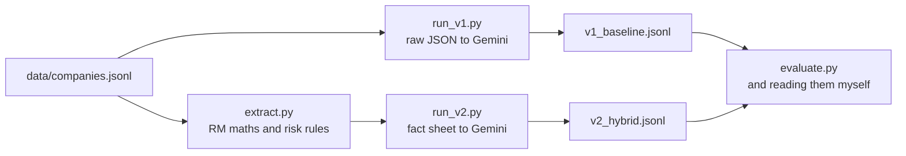

# Company Summaries Case Study

## 1. What a good summary is for this team, and why

The vetting team can already see full company record right below the summary. They will not need another long report. They just need something they can read in a short time that answers one question : 

> *Is this company worth a closer look, or should we skip it?*

Before writing any prompts, I went through all 50 records with a small script ([`src/explore.py`](src/explore.py)) to see what kinds of problems actually show up. A few things stood out.

- 2 companies are already winding up (`SYN-000545`, `SYN-001212`).
- 2 companies are listed as Active but have a pending winding-up petition against them (`SYN-000286`, `SYN-001389`). So "Active" on its own does not mean that a company is fine.
- 3 companies have no financial statements at all (`SYN-000302`, `SYN-000333`, `SYN-001203`).
- 3 companies had a problem audit opinion, either a disclaimer or a going concern warning. All 3 were in FY2022 or FY2023, not the latest year, so checking only the latest audit would have missed every one of them.
- `SYN-000451` has negative equity (RM -18,522), and 11 companies made a loss in FY2024.
- Being in court isn't always bad. 8 companies only appear as the plaintiff, meaning they're the ones suing. That's very different from being sued.

From that, I decided a good summary for this team should do five things.

1. **Put the verdict and red flags first.** If a company is being wound up, the reader should know in the first line, not after a paragraph about revenue.
2. **Stay short and plain.** Roughly 60 to 150 words, in everyday English. The full record is right there if they want the details.
3. **Skip what the page already shows.** The viewer already displays the name, registration number, industry and state, so repeating them just wastes space.
4. **Get the facts right.** No made-up numbers, always RM for money, and always clear about whether the company is suing or being sued.
5. **End with one useful next step.** The one thing worth checking before going any further.

## 2. What I have built

The idea is rather simple. For this case,  python does the maths and applies the risk rules, and the LLM only does the writing. To see whether that actually helps, I built a plain baseline first (v1) and then compared it with a split version (v2).



### Model and free tier

I used the Google AI Studio free tier with `gemini-3.5-flash-lite` for both versions. I first tried `gemini-3.8-flash`, but it kept returning `503 UNAVAILABLE` errors and the free tier only allowed 5 requests a minute. Flash-lite got through all 15 companies without a single failure.

Using the same model for both versions matters. It means any difference between v1 and v2 comes from how I set up the input, not from a bigger model.

Both scripts save each summary to `summaries/<version>.jsonl` as soon as it comes back, and skip companies that are already saved. So a rate limit or a crash never cost me the same call twice.

### The 15 companies

I did not run all 50. With the free tier limits, I would rather spend calls on companies that actually test something, and a random sample could easily miss the rare cases, like the only company with negative equity. So I picked 15 that covers every risk type I found,  and also plus 3 healthy ones to check that the system does not raise false alarms.

| Type | Companies | Why it's in the sample |
| --- | --- | --- |
| Winding up | `SYN-000545`, `SYN-001212` | The most serious case. `SYN-000545` had a going concern warning in FY2022 |
| Active, but facing a winding-up petition | `SYN-000286`, `SYN-001389` | Tests if the system still catches court danger even when status says Active |
| No financials | `SYN-000302`, `SYN-000333`, `SYN-001203` | Missing data should be called out, not guessed |
| Audit disclaimer | `SYN-000217`, `SYN-001569` | Older disclaimers (FY2022, FY2023) that a latest-year check would miss |
| Negative equity and losses | `SYN-000451` | The only company with negative equity |
| Loss-making | `SYN-000067`, `SYN-000148` | Money trouble with no court or audit issues |
| Healthy | `SYN-000267`, `SYN-000381`, `SYN-000029` | Checks for any false alarms. `SYN-000267` only has plaintiff cases and a former name, and `SYN-000381` has a corporate shareholder |

### v1, the baseline

[`src/run_v1.py`](src/run_v1.py) sends the raw JSON to Gemini with a one-line prompt. Reading the results in the viewer, four problems stood out.

- **Too long.** The average was 367 words and the longest (`SYN-000067`) was 559. They were full of terms like DSCR, DSO and cash conversion cycle, and repeated profile details the page already shows.
- **Mixed currency.** 8 of the 15  companies used MYR instead of RM. On `SYN-000302` it even wrote "MYR assumed based on context". MYR isn't wrong, but I  wanted a style the team can scan quickly.
- **Warnings came late.** On 5 of the 7 high-risk companies, the summary opened with the profile and good revenue numbers. For `SYN-000286` and `SYN-001389`, the pending winding-up petition only showed up near the bottom.
- **No two looked the same.** No two summaries opened with the same headings, 5 had emojis and 2 had tables.

### v2, Python first and then the LLM

[`src/extract.py`](src/extract.py) turns each record into a short fact sheet. It formats every amount in RM, works out the revenue change and margin, checks the audit opinion for every year (not just the latest ones), and separates cases where the company is suing from cases where it is being sued. Only Pending or Judgment entered cases are counted as live.

It then puts the company into one of three tiers.

- **HIGH RISK (likely skip)** if it is winding up, faces a live winding-up petition, has negative equity, or had a problem audit in any year.
- **CAUTION (look closer)** if it has no financials, made a loss in the latest year, or has other live cases against it.
- **LOW RISK** if none of those apply. Things like a former name, new directors in 2025 or a corporate shareholder are passed on as watch items, so they get mentioned without counting against a healthy company.

The fact sheet averages about 650 characters, compared with about 5,400 for the raw JSON, so the model reads roughly an eighth as much.

[`src/run_v2.py`](src/run_v2.py) sends only the fact sheet to the same model, with a prompt that sets the word limit and a fixed layout (Triage, Red Flags, Business & People, Money, Court Cases, Check next).

### How to run it

Add a `.env` file with Gemini key (`GEMINI_API_KEY=...`), then run

> *Free Gemini API Key is obtainable through Google AI Studio on Free Tier Plan*

```bash
uv sync --locked
uv run python src/explore.py     # look through all 50 companies (no API calls)
uv run python src/extract.py     # preview a few fact sheets (no API calls)
uv run python src/run_v1.py      # write summaries/v1_baseline.jsonl
uv run python src/run_v2.py      # write summaries/v2_hybrid.jsonl
uv run python src/evaluate.py    # print the v1 vs v2 table (no API calls)
```

### AI tools I used

I used Google Gemini as my assistant along the way, mostly to explain the concepts clearly, break the problem into smaller parts so it was easier to understand, and suggest the best ways to solve it (especially on deciding which critical risk flags to check). It also helped me troubleshoot the rate-limit errors and spot edge cases I might have missed. I ran every script myself, checked the summaries against the records in the localhost viewer, and can explain every block of code and decision here.

## 3. How I know whether it's good

For this part, I did not  use an LLM to grade the summaries. Partly to save free tier quota, and also partly because LLM judges tend to favour longer answers, which would have rewarded v1 for the exact thing I was trying to fix. Instead I used two kinds of checks, automatic ones in [`src/evaluate.py`](src/evaluate.py), and reading every v2 summary against its record.

### Automatic checks

| | `v1_baseline` | `v2_hybrid` |
| --- | --- | --- |
| Model | `gemini-3.5-flash-lite` | `gemini-3.5-flash-lite` |
| Companies | 15 | 15 |
| Average words | 366.7 | 85.9 |
| Within 60 to 150 words | 0 of 15 | 15 of 15 |
| Used MYR or $ instead of RM | 8 | 0 |
| Critical risks mentioned (13 in total) | 13 of 13 | 13 of 13 |
| High-risk companies warned in the first 30 words | 2 of 7 | 7 of 7 |

"Critical risks" here means winding up status, live winding-up petitions, no financials, negative equity and problem audits. The check looks for keywords for each one.

The first time I ran it, v1 only got 76.9%. When I looked closer, it hadn't actually missed anything. It just wrote "not provided" or "unavailable" where my check was looking for "no financial". I widened the keywords so v1 wasn't marked down for wording, and both versions ended up at 13 of 13.

So recall did not separate the two versions. Both found the big risks. The real difference was how much I had to read to get to them, and where they showed up. v2 is about 77% shorter and puts the warning at the top every time.

### One company side by side

`SYN-000286` (Cahaya Seri Catering) is a good example. The v1 summary is 414 words. It opens with a six-bullet profile box and a run of good revenue and margin numbers in MYR, and the pending High Court winding-up petition for RM 355,900 doesn't come up until around word 244.

The v2 summary is 111 words and puts it right at the top.

> **Triage:** HIGH RISK — Likely Skip
>
> **Red Flags:** Defendant in winding-up petition, debt recovery judgment, and pending tenancy dispute.
>
> - **Business & People:** Active since 2017 with 3 directors and 2 shareholders, operating in food and beverage wholesale distribution.
> - **Money:** Revenue grew to RM 4.42M, posting a profit of RM 178,923 with RM 1.95M in equity and clean audits.
> - **Court Cases:** Six total defendant cases, featuring a pending winding-up petition for RM 355,900, a debt recovery judgment of RM 97,600, and a pending tenancy dispute for RM 110,600; no plaintiff cases.
>
> **Check next:** Verify the current status of the pending winding-up petition and debt recovery judgment before any engagement.

### Reading them myself

Every automatic check was at 100%, but reading the 15 v2 summaries against the records turned up 5 mistakes.

1. **`SYN-000545`.** Red Flags correctly says the company is winding up, but the next line calls it "this active tech software firm".
2. **`SYN-000267`.** Check next mentions "the 5 active plaintiff lawsuits", but only 1 is still pending. The other 4 were settled, dismissed or withdrawn. My fact sheet only said "5 case(s)", with no status.
3. **`SYN-001569`.** Check next asks for "an updated, clean audit report to resolve the disclaimer", but the FY2023 and FY2024 audits were already clean. The fact sheet listed the FY2022 problem without saying the later years were fine.
4. **`SYN-000067`.** The summary says the company was "shifting to a loss" in FY2024. It actually lost money in all three years, and the loss got bigger every year. The fact sheet only includes the latest year's profit, so the model guessed the rest. `SYN-000148` has the same hidden pattern.
5. **`SYN-001212`.** Red Flags mentions "unpaid judgments for tenancy and employment disputes". The tenancy case does have a judgment, but both employment claims are still pending, and nothing in the record says anything is unpaid.

The pattern was the same every time. The rules and the fixed layout solved the length, the currency and the buried warnings. But wherever the fact sheet left something out, like a case's status or an earlier year's result, the model filled the gap with a guess. My automatic checks can't see this, because they only check that a risk is mentioned, not that what's said about it is true. A summary saying "not winding up" would even pass the winding up check.

## 4. What I would do next, and how I would keep improving it

1. **Fill the gaps in the fact sheet (v3).** Every mistake above traces back to something the fact sheet did not  say. I would add the status of each case on both sides (for example "5 as plaintiff, 1 pending and 4 closed"), every year's profit instead of only the latest, a clear line for the latest audit versus older ones, and a plain "NOT ACTIVE" when the status isn't Active.
2. **Check for contradictions, not just mentions.** For example, fail a summary that calls a company "active" when it is not, or mentions "active lawsuits" when none are pending. Each mistake from the manual read should become a test, so it cannot quietly come back.
3. **Run all 50, and then bigger batches.** The scripts already skip finished companies, so this is mostly changing the sample list. I would also add retries with backoff for 503 and 429 errors, and log tokens and time per company.
4. **Add more money signals, with the team.** Right now the rules look at revenue, profit, equity and audits. Next I will add cash flow and short-term liquidity. `SYN-000067` and `SYN-000148` both had negative operating cash flow in all three years and a quick ratio under 0.8 in FY2024, and the current rules never look at that. The thresholds should come from the vetting analysts, though, not from my guesses.
5. **Learn from real use.** Add a simple "this is wrong" button in the viewer so analysts can flag mistakes during normal vetting, then turn each flag into a test that runs before any prompt, rule or model change goes out.
